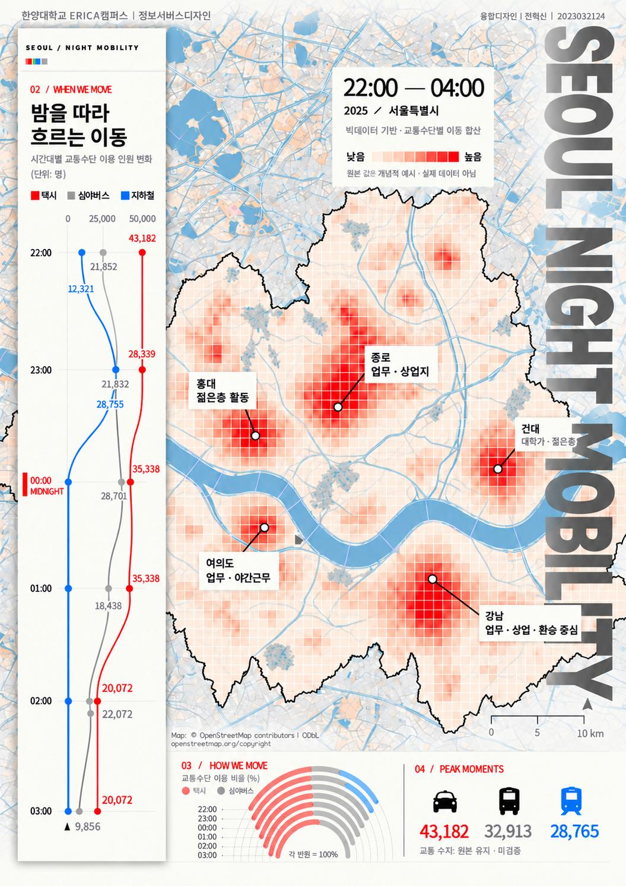

<!DOCTYPE html>
<html lang="en">
<head>
  <meta charset="UTF-8">
  <meta name="viewport" content="width=device-width, initial-scale=1">
  <title>Seoul Night Mobility | Portfolio</title>
  
</head>
<body>
  <main>
    
PORTFOLIO / INFORMATION DESIGN

    <h1>Seoul Night Mobility</h1>
    

      An information design poster exploring Seoul's
      nighttime mobility through maps, timelines,
      and transportation patterns.
    

    

      Concept visualization. Data shown in the poster
      is illustrative and does not represent actual statistics.
    

    

    <footer>Seoul Night Mobility — Poster Design</footer>
  </main>
</body>
</html>
